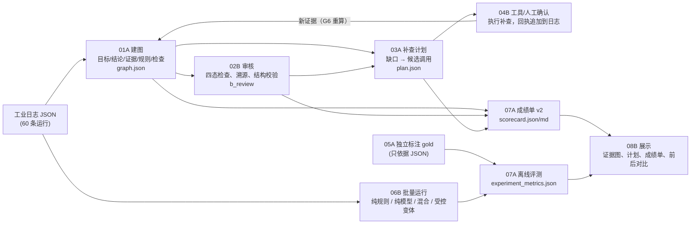

# 00 总览：新方向下的项目架构与 07A 的位置

版本：2026-11-17。依据：《工业智能体动态证据图需求说明》（2026-11-16 版，下称“需求”）、07 修正说明（2026-11-07）、五份调研报告（`_claude_work/survey/01..05`）。

> 说明：下面的分工是**根据需求、修正说明和各组已交付的代码推断的**。有些职责在代码里出现了重叠（例如 01A 也写了成绩单和补查计划），归属需要 PM 和相关组员确认，见 `04_待团队确认.md`。

## 1. 项目在做什么（一句话）

输入是一份工业智能体的运行日志（用户问题 + 工具调用轨迹 + 最终回答）。系统要：

1. 把回答拆成一条条结论，把每条结论连到日志里的具体字段，形成“证据图”；
2. 判断每条结论是“已支持 / 与证据矛盾 / 证据不足 / 来源冲突 / 缺适用规则”；
3. 对缺证的地方给出补查计划（查什么工具、用什么参数、怎样算补到了）；
4. 生成一份置信度成绩单，告诉复核人员哪里可信、哪里要先看；
5. 离线用独立标注衡量整套方法好不好。

唯一的工程输入是 `111/工业智能体模拟监控日志_60条(1).json`（60 条运行）。配套的《案例说明 md》**禁止**用于构图、规则、提示词、补证、评分和验收标注（需求 §2）。

## 2. 架构图



两条线要分开看：

- **上面是在线链路**：针对一次运行，产出证据图、补查计划和成绩单。成绩单不读 gold。
- **下面是离线评测**：拿多次运行的结果和独立标注对比，算指标。评测不反过来影响单次成绩单。

## 3. 各角色的职责与接口

| 角色 | 在新方向下负责什么 | 主要输出（文件/字段） | 当前状态（据调研） | 归属是否清楚 |
|---|---|---|---|---|
| 01A 证据链 A | 需求 G1–G6：拆目标和结论、证据定位、规则、确定性检查、AND/OR 路径、补证后重算 | `<case>_graph.json`（goals、nodes、edges、checks、paths、gaps）；还自带 `<case>_plan.json` 和 `<case>_scorecard.json`（v1） | `evidence_graph3` 已能离线跑 60 条（rule 模式），57 项测试通过 | 建图清楚。**成绩单 v1 和补查计划与 07A、03A 重叠**，待确认 |
| 02B 证据链 B | 四态/语义复核、来源定位校验、结构校验、基础必查 | `b_review{issues, provenance, local_review}`；`prediction.structural_passed` | 结构校验 60/60；语义局部检查只覆盖 5 条运行（12 项检查）；claim 编号不用 01A 的 CLM | 职责清楚，**四态还是五态未统一** |
| 03A Loop A | 需求 B1–B2：从缺口反推补查动作，给已知/待确认参数，预算与停止 | 补查计划（动作类型、工具、参数、成功判据、可执行性） | 工业方向**未见 03A 的独立代码**；目前计划由 01A 的 `plan.py` 产出 | **不清楚**，推断为 03A |
| 04B Loop B | 需求 B3：工具注册与参数契约、执行补查、记录回执和取证时间、人工确认单 | 回执（调用参数、返回、失败原因、时间） | `loop_b_unified/` 是补偿时代代码；工业方向**暂无可调用工具** | 推断为 04B，工业版待定义 |
| 05A 测试 A | 独立 gold 标注（只依据 JSON）：关键结论、证据字段、应补查内容；变体期望 | gold 文件（逐结论、逐缺口、补查参数） | 现有“起步案例集 v0.7”是补偿方向；工业 gold **尚无**。07A 起草了 15 条试点（AI 草稿） | 推断为 05A |
| 06B 测试 B | 批量运行：纯规则 / 纯模型 / 混合、受控变体、记录失败与耗时 | `results/<method>/<run_id>_<时间戳>.json` | 只有 `evidence_rule/`（60×3 批），结构测试 127 通过；无 llm/hybrid；无变体 | 职责清楚，输出字段待补 |
| **07A 置信度 A（本岗位）** | 成绩单评分口径与实现；离线指标、方法对照、变体敏感性、校准 | 成绩单 v2；`experiment_metrics.json`、`report.md`、csv | 本交付 | 评分口径清楚；**与 01A v1 成绩单的关系待确认** |
| 08B 置信度 B | 展示：证据图、补查计划、成绩单、补证前后对比、实验区 | Streamlit `app_final.py`（`confidence-b-demo` 分支） | 目前数据是硬编码的 4 个案例，没有读 07A 文件；实验区会查找 `experiment_metrics.json` | 清楚。注意 `scene_tag` 来自案例说明 |
| PM（forest1119） | 需求、数据、合并 PR、拍板口径 | 需求说明、日志 JSON | 已上传工业日志与需求 | — |

## 4. 07A 的位置：吃什么、产出什么

### 4.1 在线成绩单

```
01A graph.json + plan.json ──┐
(或 06B results/*.json)      ├─> adapters/egraph_v1.py ─> RunView ─> scorecard.score_run ─> 成绩单 v2
02B industrial_results.json ─┤        (可选) adapters/b_review.py 覆盖层
日志 JSON（回答原文、指针）  ─┘
```

消费的上游字段（详见 `02_接口契约.md`）：

- 01A：claim 节点的 `evidence_status`、`assertion_strength`、`related_goals`、`meta.verdict_reason`；`goals[]`；`checks[]`；`gaps[]`（类型、关键度、受影响结论）；`edges[]`；plan 的 `actions[]`（目标结论、可执行性）。
- 02B（可选）：`local_review.checks[]` 的 `state`，按回答片段明确匹配到 01A 结论时才覆盖。
- 日志：`ai_answer`（措辞判定、未映射句子）、trace 下标（生成 JSON 指针）。

产出（每个 run 一份）：

- 08B 已在读的顶层字段：`rule_version`、`support_score`、`coverage_score`、`uncertainty_score`、`high_risk_alert`、`scope_note`、`review_sequence`。
- 计分依据：`grade`（三档）、`blockers[]`、`qualifications[]`、`severe_issues[]`、各维度分子/分母、逐结论明细（原文、措辞、状态、依据的 `run_id + 事件 ID + json_path`、缺口、受影响目标、补证动作）、`build_risks`、`score_semantics`、`policy_sha256`。
- 补证前后对比：`diff_scorecards(before, after)`。

### 4.2 离线评测

```
06B 各方法结果目录 ─┐
05A gold（gold.v1） ─┼─> eval/align → eval/metrics → eval/report ─> experiment_metrics.json（08B 读）
成绩单 v1 / v2      ─┘                                              report.md, per_claim.csv, per_run.csv
```

主要指标（需求 §6）：错误结论被判为支持的比例（FSR）、证据不足被误判为错误的比例（IAE）、缺口定位 P/R/F1、补查参数定位准确率；另有五态混淆矩阵、严重问题召回、校准表（仅描述性）。定义见 `03_评测与指标.md`，实验数字见该文件 §实验结果。

## 5. 两条硬边界

1. **评分不能修复上游的语义错误。** 例如 01A 把 IND-053“今天吊装18吨设备没有问题”判成 SUPPORT，07A 不改。这类错误由 FSR 等指标暴露，并列入 `06_对接需求与群消息.md` 的上游问题清单。
2. **在线与离线分开。** 在线成绩单不读 gold、不读案例说明；离线评测的 gold 只依据 JSON 标注。案例说明最多只能用于一个默认关闭、需团队同意的“事后对照”。
